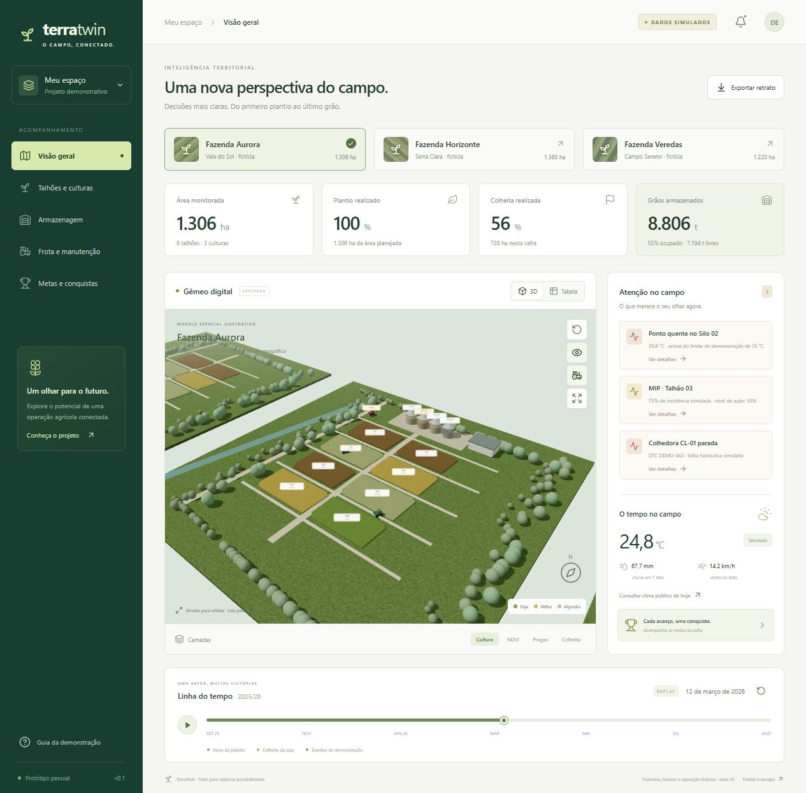

# TerraTwin

**Um olhar espacial sobre toda a safra.** Protótipo pessoal de gêmeo digital agrícola, com três fazendas fictícias, navegação 3D e uma safra reproduzível.

[Abrir demonstração](https://alexandrecarrascosa.github.io/terratwin/) · [Roteiro de apresentação](docs/DEMO.md) · [Arquitetura e limites](docs/ARCHITECTURE.md)

> **DADOS SIMULADOS.** Não representa nenhuma empresa, propriedade ou operação real. Não contém CAR, perímetros, credenciais, dados de funcionários ou integrações corporativas. O terreno também é procedural e fictício.



## O que dá para explorar

- **Três fazendas:** Aurora, Horizonte e Veredas. O seletor faz o voo de câmera e atualiza os indicadores.
- **24 talhões e três culturas:** soja, milho e algodão; painel por talhão com área, estádio, NDVI, MIP, solo e graus-dia sintéticos.
- **Camadas:** cultura, NDVI, incidência de pragas e colheita.
- **Uma safra inteira:** replay diário entre 01/09/2025 e 31/08/2026, com atalhos para eventos.
- **Armazenagem:** saldo por armazém, capacidade livre, quatro silos por fazenda, preenchimento 3D proporcional e ponto quente roteirizado. Soja e milho separados; algodão não entra no estoque de grãos.
- **Frota:** três máquinas genéricas por fazenda, diagnóstico e ordem corretiva fictícios.
- **Metas por fazenda:** plantio na janela, colheita concluída e sequência sem ponto quente; comparação proporcional, sem ranking de pessoas.
- **Acesso alternativo:** tabela pesquisável, navegação por teclado, modo inicial em tabela no celular e fallback quando o WebGL não está disponível.
- **Exportação:** retrato do talhão em CSV, com indicação de origem simulada.
- **Clima público opcional:** consulta atual do Open-Meteo para uma referência regional em Cuiabá, claramente separada das fazendas e do clima sintético do replay.

## Executar localmente

Requisitos: **Node.js 22.12+** e npm. Python **3.10+** só é necessário para regenerar os dados.

```bash
git clone https://github.com/AlexandreCarrascosa/terratwin.git
cd terratwin
npm ci
npm run dev
```

Abra o endereço mostrado pelo terminal. Navegadores recomendados para o 3D: Chrome ou Edge com WebGL2 e aceleração gráfica. Não há chave de API, cadastro nem servidor de dados para configurar.

```bash
npm test                # Regras de domínio e invariantes para todos os dias/fazendas
npm run build           # TypeScript + build de produção
npm run preview         # Servir o resultado de produção
npm run data:generate   # Regenerar fixtures com Python e seed 42
npm run test:e2e        # Testes de interface com Playwright
```

Para os testes de interface, execute uma vez `npx playwright install chromium`. A configuração de testes inicia o servidor automaticamente. Os testes também rodam no GitHub Actions.

## Demonstração em 15 minutos

Abra **Guia da demonstração** no menu. Os atalhos restauram a data de 12/03/2026 e o contexto correspondente. Nessa data:

1. Aurora tem um ponto quente no Silo 02, um alerta de MIP no Talhão 03 e uma colhedora em falha.
2. Horizonte demonstra um armazém perto da capacidade e a conquista de plantio na janela.
3. Ao avançar a linha do tempo, os eventos se encerram e a colheita evolui até 100%.

Veja o [roteiro completo](docs/DEMO.md), inclusive as perguntas de negócio para uma apresentação.

## Dados, segurança e honestidade do protótipo

O gerador Python usa somente a biblioteca padrão e `random.Random(42)`. Não consulta fontes externas. As mesmas entradas produzem o mesmo JSON. O modelo TypeScript deriva os indicadores dessa referência e da data escolhida.

O estoque obedece a `abertura + recebimentos − expedições`. A alocação por silo é simulada, não um detalhamento vindo do SAP. Os testes cobrem os 365 dias das três fazendas, com conservação de massa, capacidade por silo, avanço de plantio/colheita e consistência dos alertas.

Esta entrega é uma demonstração de interface e de regras simplificadas. **Não inclui** terreno Copernicus, mosaicos Sentinel-2, NDVI observado, mapa georreferenciado, shapefile/CAR, autenticação, RBAC, persistência, PWA offline, integração SAP/JD/Case/Zeus ou emissão de receituário. Os valores de fenologia, pragas e qualidade não devem orientar operações reais. [Detalhes e caminho de evolução](docs/ARCHITECTURE.md).

Todos os dados distribuídos com o frontend são públicos por definição. Não adicione informações reais ou segredos ao JSON, código, commits, Issues ou variáveis `VITE_*`. Um sistema oficial precisa de backend, controle de acesso, auditoria e backups antes de receber dados reais.

## Publicação

O workflow [validar-publicar.yml](.github/workflows/validar-publicar.yml) valida os dados, executa testes, compila a aplicação e publica `dist/` no GitHub Pages a cada push em `main`. A configuração do Pages deve usar **GitHub Actions**. Pull requests executam os mesmos testes, sem publicação.

O aplicativo é estático e também pode ser servido por Nginx, Caddy ou outro servidor HTTP. O caminho base relativo permite hospedá-lo em uma subpasta. Não há dependência de serviços pagos.

## Tecnologia e créditos

React 19 · TypeScript · Vite · Three.js · React Three Fiber · Drei · Lucide · Vitest · Playwright. Modelos 3D e texturas criados em código; nenhum ativo comercial, logotipo corporativo ou recurso de Cesium ion.

O clima atual opcional usa [Open-Meteo](https://open-meteo.com/), com dados atribuídos sob [CC BY 4.0](https://creativecommons.org/licenses/by/4.0/). Consulte os termos do provedor antes de uso comercial ou de grande volume. A consulta exige internet; a demonstração não depende dela. Fontes e dependências usam suas respectivas licenças; consulte [THIRD_PARTY_NOTICES.md](THIRD_PARTY_NOTICES.md).

Código e dados sintéticos sob licença [MIT](LICENSE).
