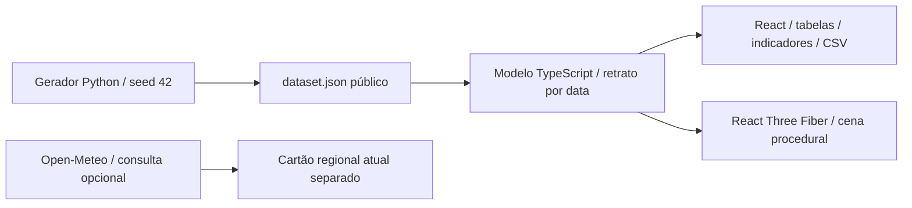

# Arquitetura, modelo e evolução

## Decisão desta entrega

Aplicação estática, sem backend. Esta é a menor arquitetura que entrega a exploração navegável do protótipo sem credenciais, infraestrutura paga ou sistemas de registro ficticiamente apresentados como prontos.

## Organização

| Arquivo                    | Responsabilidade                                                                   |
| -------------------------- | ---------------------------------------------------------------------------------- |
| `scripts/generate_data.py` | Três fazendas, 24 talhões, calendário, produção esperada e clima diário sintéticos |
| `src/data/dataset.json`    | Fixture pública versionada, schema v1                                              |
| `src/model.ts`             | Datas, estádios, NDVI, MIP, estoque, silos, alertas e indicadores                  |
| `src/Scene.tsx`            | Terreno, texturas, árvores instanciadas, talhões, estruturas, máquinas e câmera    |
| `src/App.tsx`              | Navegação, seleção, detalhes, tabelas, replay, guia e exportação                   |
| `src/styles.css`           | Interface adaptativa, foco visível e redução de movimento                          |
| `src/model.test.ts`        | Invariantes para todos os dias da safra                                            |
| `tests/smoke.spec.ts`      | Percursos de interface, celular e exportação                                       |

## Premissas do modelo sintético

- Safra entre 01/09/2025 e 31/08/2026. Datas processadas ao meio-dia UTC, sem dependência do fuso da máquina.
- Plantio e colheita avançam linearmente em suas janelas, por talhão. Não é um simulador agronômico calibrado.
- Estádio derivado de idade/ciclo; graus-dia acumulados do clima sintético, limitados até a maturação. A fenologia não é ajustada por um modelo científico.
- NDVI é uma curva ilustrativa de crescimento e senescência, não sensoriamento remoto.
- Surto em Aurora/T03 de 05 a 19/03; aplicação fictícia em 20/03. Falha da colhedora entre 10 e 17/03. Ponto quente no Silo 02 entre 08 e 22/03.
- Abertura de estoque só de soja. Recebimentos = produção colhida de soja e milho. Algodão segue cadeia distinta e não ocupa os silos de grãos.
- Expedição de soja: 8 t/dia, limitada ao disponível. Expedição de milho: 70% do recebimento acumulado, para representar escoamento durante o recebimento. Sem perdas ou terceiros nesta versão.
- Três silos dedicados à soja e um ao milho, com capacidades de exemplo diferentes. A soma dos saldos e capacidades individuais coincide com a do armazém. Geometria 3D ilustrativa; dimensões físicas não são usadas para cubagem.
- Objetivos e limiares são fictícios; sem aprovação, auditoria ou conselho agronômico. Os números não devem ser interpretados como limites seguros reais.

As entidades do protótipo são um subconjunto conceitual da visão futura. **Não** existe promessa de compatibilidade direta com um schema SAP, PostGIS ou fornecedor de telemetria. Haverá mapeamento e validação nos conectores.

## Fronteiras para evolução

1. **Contrato de leitura:** extrair a interface de repositório a partir de `farmSnapshot`; manter `id`, fazenda, data, unidade, origem e qualidade para cada leitura. Substituir as fixtures por uma API validada, sem expor tokens ao navegador.
2. **Geografia real:** obter uma área autorizada, validar CRS, importar GeoJSON/PostGIS e usar DEM e imagens com licença compatível. Os retângulos e coordenadas locais da cena atual precisam ser substituídos; não são georreferenciados. Validar Cesium vs MapLibre/deck.gl/R3F com um recorte pequeno antes de gerar terreno em escala.
3. **Clima e NDVI históricos:** cache, proveniência, data de aquisição, máscara de nuvens e apresentação explícita de dados ausentes. A consulta atual do Open-Meteo não serve como histórico da safra.
4. **Armazém:** leitura EWM por depósito/produto/lote. Fonte separada para nível por silo, com método, data e incerteza. Conciliação dos totais, bloqueio de dupla contagem e rastreabilidade de movimentos.
5. **Telemetria e termometria:** somente após autorização, prova de conectividade e validação das APIs/CSV dos provedores. Agendamento, limites, renovação OAuth, segredo no servidor e tratamento de dados atrasados.
6. **Sistema oficial:** API, autenticação/SSO, RBAC por fazenda, RLS Postgres, auditoria, retenção, backups testados e observabilidade antes de permitir escrita em MIP, aplicações e manutenção.
7. **Campo:** importação Excel validada e PWA offline com estratégia de conflitos e proteção de dados; não implementados aqui.

## Desempenho e acessibilidade

A cena 3D é carregada separadamente, usa árvores instanciadas e limita a resolução por pixel. Rótulos e máquinas podem ser ocultados. Nenhum mapa remoto é baixado na abertura. A tabela evita depender de WebGL e oferece o equivalente de leitura aos dados da cena.

As metas de menos de 5 s e 30 fps da visão do produto **não são garantidas**: precisam ser medidas em hardware, rede e volume de dados definidos. O protótipo foi pensado para notebooks com WebGL2; celular inicia pela tabela. Preferência por movimento reduzido evita voos animados; o replay depende de ação do usuário.

## Limites operacionais

Sem conta, persistência, escrita, autorização real, trilha de auditoria ou SLA. O estado de navegação reinicia ao recarregar. Sem service worker ou promessa de operação offline; uma cópia servida localmente funciona sem chamadas externas, exceto a consulta pública opcional de clima. Sem processamento real de shapefile, MIP Excel ou receituário. Não usar como fonte oficial para estoque, manutenção ou decisão agronômica.
