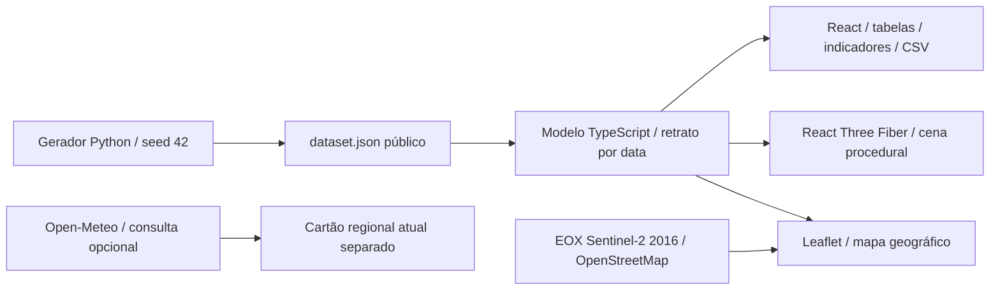

# Arquitetura, modelo e evolução

## Decisão desta entrega

Aplicação estática, sem backend. Esta é a menor arquitetura que entrega a exploração navegável do protótipo sem credenciais, infraestrutura paga ou sistemas de registro ficticiamente apresentados como prontos.

## Organização

| Arquivo                    | Responsabilidade                                                                   |
| -------------------------- | ---------------------------------------------------------------------------------- |
| `scripts/generate_data.py` | Três fazendas, 24 talhões, calendário, produção esperada e clima diário sintéticos |
| `src/data/dataset.json`    | Fixture pública versionada, schema v1                                              |
| `src/model.ts`             | Datas, estádios, NDVI, MIP, estoque, silos, alertas e indicadores                  |
| `src/Scene.tsx`            | Terreno, texturas, árvores instanciadas, talhões, estruturas, máquinas e câmera    |
| `src/App.tsx`              | Navegação, seleção, detalhes, tabelas, replay, guia e exportação                   |
| `src/styles.css`           | Interface adaptativa, foco visível e redução de movimento                          |
| `src/model.test.ts`        | Invariantes para todos os dias da safra                                            |
| `tests/smoke.spec.ts`      | Percursos de interface, celular e exportação                                       |

## Geografia e fluxo de seleção

`src/GeoMap.tsx` integra diretamente Leaflet ao React, com criação e limpeza explícitas do mapa, das camadas, dos eventos e do observador de tamanho. `src/geography.ts` concentra centros de referência, projeção local e configuração dos fundos. Não há wrapper com licença restritiva.

O mapa geral inicia sem unidade selecionada. Os três marcadores correspondem a referências regionais em Nova Mutum/MT, Rondonópolis/MT e Luís Eduardo Magalhães/BA. Os indicadores iniciais são consolidados; escolher um marcador ou cartão libera os detalhes, a tabela e o 3D daquela unidade. “Todas as unidades” retorna ao conjunto e remove a seleção.

As sobreposições são polígonos de exemplo em latitude/longitude, com área preservada pela projeção local. A rotação e os limites são fictícios, não correspondem à segmentação dos terrenos vistos na imagem nem a perímetros cadastrais. O mosaico EOX 2016 é real, histórico, com atribuição e licença CC BY 4.0; não muda com o replay. O 3D permanece uma representação procedural separada, com paisagem contínua, sem DEM real.

O carregamento de mapas é interativo, sem prefetch ou recurso offline. Há troca de fundo e mensagem de indisponibilidade; os testes de interface interceptam tiles externos para não consumir os servidores públicos.

## Premissas do modelo sintético

### Telemetria demonstrativa

`telemetry.ts` gera posição GPS, posição local, velocidade física, rumo, estado e horário por máquina. O `useTelemetry` mantém um relógio compartilhado entre mapa, 3D e painel. Pacotes chegam a cada segundo, com reprodução de 1× ou 20× explicitamente indicada. As rotas são interiores aos polígonos de exemplo, com linhas de trabalho e manobras mais lentas. A falha roteirizada imobiliza a colhedora. O replay define o contexto e as falhas; o relógio ao vivo é uma demonstração hipotética independente, não uma operação histórica observada.

Os marcadores Leaflet são persistentes e interpolados sem reconstruir o mapa. Rastros ficam limitados a 30 pontos. Pausa e troca de contexto cancelam animações; a atualização é suspensa com a aba oculta. O 3D usa o mesmo pacote e redesenha até 30 vezes por segundo enquanto a reprodução está ativa; parado, retorna à renderização sob demanda. A cena usa troncos, ramos e folhas instanciados, evitando uma malha/objeto por árvore e as antigas copas sólidas.

Não há conector real de telemetria nem afirmação de latência, precisão de GPS ou desempenho garantido em hardware específico. A futura ingestão precisa validar os pacotes e lidar com ausência de sinal, ordenação, saltos e expiração das leituras.

### Safra e estoque

- Safra entre 01/09/2025 e 31/08/2026. Datas processadas ao meio-dia UTC, sem dependência do fuso da máquina.
- Plantio e colheita avançam linearmente em suas janelas, por talhão. Não é um simulador agronômico calibrado.
- Estádio derivado de idade/ciclo; graus-dia acumulados do clima sintético, limitados até a maturação. A fenologia não é ajustada por um modelo científico.
- NDVI é uma curva ilustrativa de crescimento e senescência, não sensoriamento remoto.
- Surto em Aurora/T03 de 05 a 19/03; aplicação fictícia em 20/03. Falha da colhedora entre 10 e 17/03. Ponto quente no Silo 02 entre 08 e 22/03.
- Abertura de estoque só de soja. Recebimentos = produção colhida de soja e milho. Algodão segue cadeia distinta e não ocupa os silos de grãos.
- Expedição de soja: 8 t/dia, limitada ao disponível. Expedição de milho: 70% do recebimento acumulado, para representar escoamento durante o recebimento. Sem perdas ou terceiros nesta versão.
- Três silos dedicados à soja e um ao milho, com capacidades de exemplo diferentes. A soma dos saldos e capacidades individuais coincide com a do armazém. Geometria 3D ilustrativa; dimensões físicas não são usadas para cubagem.
- Objetivos e limiares são fictícios; sem aprovação, auditoria ou conselho agronômico. Os números não devem ser interpretados como limites seguros reais.

As entidades do protótipo são um subconjunto conceitual da visão futura. **Não** existe promessa de compatibilidade direta com um schema SAP, PostGIS ou fornecedor de telemetria. Haverá mapeamento e validação nos conectores.

## Fronteiras para evolução

1. **Contrato de leitura:** extrair a interface de repositório a partir de `farmSnapshot`; manter `id`, fazenda, data, unidade, origem e qualidade para cada leitura. Substituir as fixtures por uma API validada, sem expor tokens ao navegador.
2. **Perímetros e relevo reais:** substituir os polígonos de demonstração por uma área autorizada, validar CRS e importar GeoJSON/PostGIS. O Leaflet já fornece a base geográfica real. Para o 3D geográfico, obter DEM e validar Cesium vs MapLibre/deck.gl/R3F com um recorte pequeno antes de gerar terreno em escala. Não tratar os limites sintéticos como limites da imagem de fundo.
3. **Clima e NDVI históricos:** cache, proveniência, data de aquisição, máscara de nuvens e apresentação explícita de dados ausentes. A consulta atual do Open-Meteo não serve como histórico da safra.
4. **Armazém:** leitura EWM por depósito/produto/lote. Fonte separada para nível por silo, com método, data e incerteza. Conciliação dos totais, bloqueio de dupla contagem e rastreabilidade de movimentos.
5. **Telemetria e termometria:** somente após autorização, prova de conectividade e validação das APIs/CSV dos provedores. Agendamento, limites, renovação OAuth, segredo no servidor e tratamento de dados atrasados.
6. **Sistema oficial:** API, autenticação/SSO, RBAC por fazenda, RLS Postgres, auditoria, retenção, backups testados e observabilidade antes de permitir escrita em MIP, aplicações e manutenção.
7. **Campo:** importação Excel validada e PWA offline com estratégia de conflitos e proteção de dados; não implementados aqui.

## Desempenho e acessibilidade

A cena 3D é carregada somente depois de escolher uma unidade e abrir o modo 3D; usa renderização sob demanda, árvores instanciadas e resolução por pixel limitada. Rótulos e máquinas podem ser ocultados. O mapa Leaflet carrega apenas os tiles da área visível e funciona sem WebGL. A tabela oferece o equivalente de leitura aos dados da cena.

As metas de menos de 5 s e 30 fps da visão do produto **não são garantidas**: precisam ser medidas em hardware, rede e volume de dados definidos. O mapa geral é a entrada também no celular; o 3D requer WebGL2. Preferência por movimento reduzido evita voos animados; o replay depende de ação do usuário.

## Limites operacionais

Sem conta, persistência, escrita, autorização real, trilha de auditoria ou SLA. O estado de navegação reinicia ao recarregar. Sem service worker ou promessa de operação offline. O mapa e o clima público precisam de internet; dados, tabela e 3D são distribuídos com a aplicação. Sem processamento real de shapefile, MIP Excel ou receituário. Não usar como fonte oficial para estoque, manutenção ou decisão agronômica.
